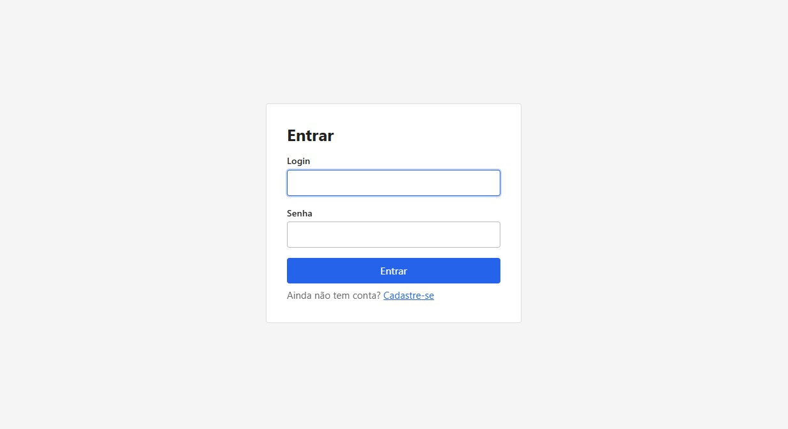
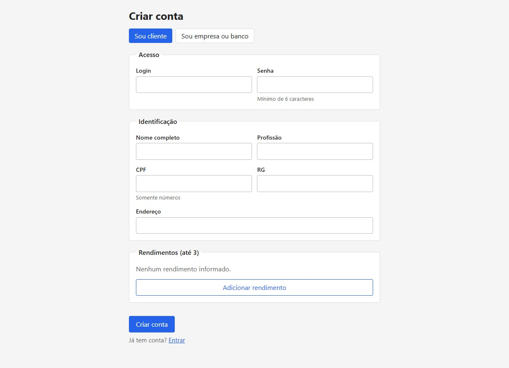
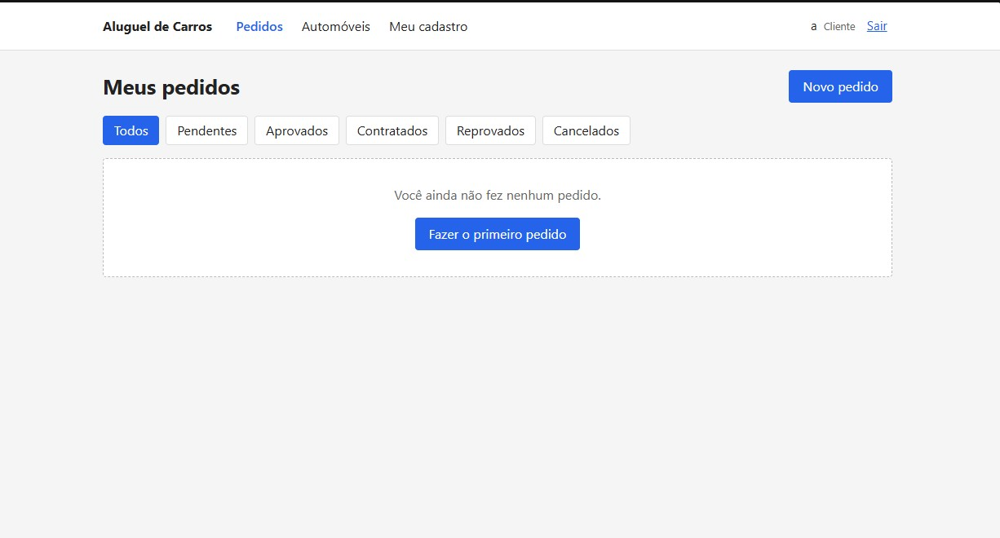
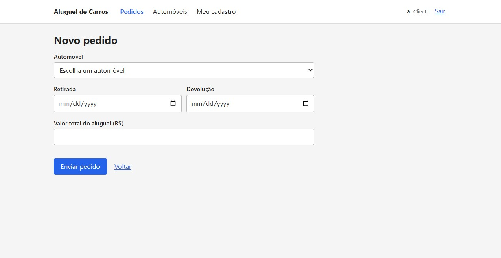
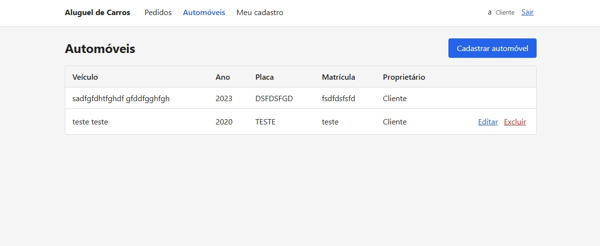
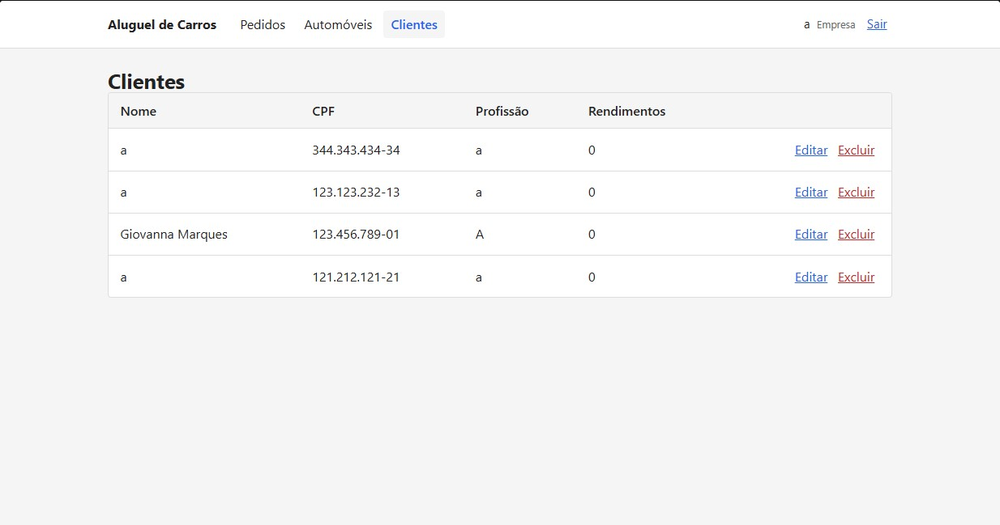

<!-- Este template foi criado para servir como referência e pode ser facilmente adaptado para diferentes projetos de desenvolvimento -->

---

# 🚗 Sistema de Aluguel de Carros 👨‍💻
 
> [!NOTE]
> Plataforma web para **gestão de pedidos de aluguel de automóveis**: o cliente solicita e acompanha o aluguel, enquanto empresas e bancos analisam, contratam e financiam.


## 🚧 Status do Projeto
 
       
 
---
 
## 📚 Índice
- [Links Úteis](#-links-úteis)
- [Sobre o Projeto](#-sobre-o-projeto)
- [Funcionalidades Principais](#-funcionalidades-principais)
- [Tecnologias Utilizadas](#-tecnologias-utilizadas)
- [Arquitetura](#-arquitetura)
  - [Diagramas](#diagramas)
- [Instalação e Execução](#-instalação-e-execução)
  - [Pré-requisitos](#pré-requisitos)
  - [Variáveis de Ambiente](#-variáveis-de-ambiente)
     - [1 Back-end (Spring Boot)](#1-back-end-spring-boot)
     - [2 Front-end (React, Vite)](#2-front-end-react-vite)
  - [Instalação de Dependências](#-instalação-de-dependências)
    - [Front-end (React)](#front-end-react)
    - [Back-end (Spring Boot)](#back-end-spring-boot)
  - [Inicialização do Banco de Dados (Supabase)](#-inicialização-do-banco-de-dados-supabase)
  - [Como Executar a Aplicação](#-como-executar-a-aplicação)
    - [Terminal 1: Back-end (Spring Boot)](#terminal-1-back-end-spring-boot)
    - [Terminal 2: Front-end (React, Vite)](#terminal-2-front-end-react-vite)
- [Deploy](#-deploy)
- [Estrutura de Pastas](#-estrutura-de-pastas)
- [Demonstração](#-demonstração)
  - [Aplicação Web](#-aplicação-web)
  - [Exemplo de saída no Terminal (API)](#-exemplo-de-saída-no-terminal-api)
- [Testes](#-testes)
- [Documentações utilizadas](#-documentações-utilizadas)
- [Autores](#-autores)
- [Contribuição](#-contribuição)
- [Agradecimentos](#-agradecimentos)
- [Licença](#-licença)
---
 
## 🔗 Links Úteis
* 📖 **Histórias de Usuário e RNFs:** [Leia o documento](./docs/historias-de-usuario.md)
  > 📚 **Descrição:** Histórias de usuário com critérios de aceitação e requisitos não funcionais atendidos.
* 🧩 **Diagramas UML:** [Abrir pasta de diagramas](./docs/diagramas)
  > 📐 **Descrição:** Casos de Uso, Classes e Pacotes (Visão Lógica), em PNG e PlantUML.
* 🗄️ **Esquema do Banco de Dados:** [Ver `schema.sql`](./docs/schema.sql)
  > 💾 **Descrição:** Esquema de referência das tabelas no PostgreSQL.
---
 
## 📝 Sobre o Projeto
 
Locadoras e bancos precisam analisar a viabilidade financeira de cada aluguel antes de formalizar o contrato, e o cliente precisa saber em que etapa está o seu pedido. O sistema resolve isso reunindo, em um único fluxo web, o **pedido do cliente**, a **análise financeira do agente**, a **execução do contrato** e, opcionalmente, o **financiamento por um banco**.
 
- **Por que ele existe:** atender à especificação do Laboratório 02, que pede um protótipo web com autenticação, CRUD de cliente e criação/visualização do status de pedidos de aluguel.
- **Qual problema ele resolve:** a falta de visibilidade e de padronização entre quem solicita, quem analisa e quem contrata um aluguel.
- **Qual o contexto:** acadêmico, em Engenharia de Software (PUC Minas).
- **Onde pode ser utilizado:** em cenários reais ou simulados de locadoras de veículos e instituições financeiras parceiras.
### Ciclo de vida do pedido
 
```
PENDENTE ──aprovação──▶ APROVADO ──contrato──▶ CONTRATADO
    ├──reprovação──▶ REPROVADO
    └──cliente cancela──▶ CANCELADO
```
 
> [!NOTE]
> A modelagem (casos de uso, histórias de usuário, classes e pacotes) é mantida atualizada na pasta [`docs`](./docs) conforme o código evolui.
 
---
 
## ✨ Funcionalidades Principais
 
- 🔐 **Autenticação Segura:** login e cadastro de clientes e agentes, com senhas em BCrypt e sessão via JWT.
- 👤 **CRUD de Cliente:** cadastro com RG, CPF, nome, endereço, profissão e até 3 rendimentos; consulta, edição e exclusão.
- 🏢 **Cadastro de Agentes:** empresas e bancos, identificados por CNPJ e tipo.
- 🚘 **Gestão de Automóveis:** matrícula, ano, marca, modelo e placa, com proprietário (cliente, empresa ou banco).
- 📄 **Pedidos de Aluguel:** criação, modificação, cancelamento e acompanhamento de status, com filtro por status.
- ✅ **Análise Financeira:** o agente emite parecer positivo ou negativo e executa o contrato.
- 🏦 **Contrato de Crédito:** bancos associam valor financiado, juros ao mês e parcelas ao aluguel.
- 🛡️ **Controle de Acesso por Perfil:** o cliente só acessa os próprios dados e pedidos; os agentes avaliam e modificam.
---
 
## 🛠 Tecnologias Utilizadas
 
As seguintes ferramentas, frameworks e bibliotecas foram utilizados na construção deste projeto. Recomenda-se o uso das versões listadas (ou superiores) para garantir a compatibilidade.
 
### 💻 Front-end
 
* **Framework/Biblioteca:** React 19
* **Roteamento:** React Router 7
* **Linguagem/Superset:** JavaScript (JSX)
* **Estilização:** CSS (`styles.css`)
* **Gerenciamento de Estado:** Context API (`AuthContext`)
* **Build Tool:** Vite 7
### 🖥️ Back-end
 
* **Linguagem/Runtime:** Java 25 (JDK)
* **Framework:** Spring Boot 4.0.0 (Web MVC, Validation)
* **Banco de Dados:** Supabase (PostgreSQL)
* **ORM / Query Builder:** Spring Data JPA / Hibernate
* **Autenticação:** Spring Security + OAuth2 Resource Server (JWT HS256) + BCrypt
* **Build:** Maven
---
 
## 🏗 Arquitetura
 
O sistema segue o padrão **MVC**: o **Model** são as entidades JPA, o **Controller** expõe a API REST e a **View** é a SPA React, que consome JSON. As regras de negócio ficam na camada **service** e a persistência na camada **repository**.
 
- **Visão geral:** SPA React (front-end) + API REST em Spring Boot (back-end) + PostgreSQL no Supabase.
- **Principais componentes:** `controller` (endpoints), `service` (regras), `repository` (acesso a dados), `model` (entidades), `dto` (contratos de entrada e saída), `security`/`config` (JWT, CORS e rotas públicas) e `exception` (tratamento global de erros).
- **Padrões de design adotados:** Controller → Service → Repository, DTOs e handler global de exceções.
- **Fluxo de dados:** React (`api.js`) → HTTP/JSON + JWT → Controller → Service → Repository → Supabase.
- **Decisões arquiteturais:** API *stateless*; a claim `perfil` (`CLIENTE` | `AGENTE`) do token vira a role usada em `@PreAuthorize`; em desenvolvimento, o Vite encaminha `/api` ao back-end, evitando CORS.
- **Trade-offs:** o schema é gerado pelo Hibernate (`ddl-auto: update`), o que agiliza o desenvolvimento, mas não substitui migrações versionadas (Flyway/Liquibase) em produção.
### Diagramas
 
| Diagrama de Casos de Uso | Diagrama de Classes |
| :---: | :---: |
|  |  |
 
| Diagrama de Pacotes (Visão Lógica) |
| :---: |
|  |
 
---
 
## 🔧 Instalação e Execução
 
### Pré-requisitos
Certifique-se de que o ambiente esteja configurado.
 
* **Java JDK:** Versão **25** (Necessário para o **Back-end Spring Boot**)
* **Maven:** Versão 3.9 ou superior
* **Node.js:** Versão **20.19** ou superior (Necessário para o **Front-end React**)
* **Gerenciador de Pacotes:** npm
* **Conta no Supabase:** [supabase.com](https://supabase.com) (banco de dados PostgreSQL)
---
 
### 🔑 Variáveis de Ambiente
 
#### 1 Back-end (Spring Boot)
 
Copie o modelo e preencha os valores:
 
```bash
cd backend
cp .env.example .env
```
 
| Variável | Descrição | Exemplo |
| :--- | :--- | :--- |
| `SUPABASE_DB_PASSWORD` | Senha do banco de dados no Supabase. | `sua-senha-do-banco` |
| `JWT_SECRET` | Chave secreta para assinatura dos tokens (**mínimo de 32 caracteres**). | `uma-chave-secreta-com-pelo-menos-32-caracteres` |
| `SUPABASE_DB_URL` | URL de conexão JDBC (opcional; padrão em `application.yml`). | `jdbc:postgresql://aws-0-us-east-1.pooler.supabase.com:5432/postgres?sslmode=require` |
| `SUPABASE_DB_USER` | Usuário do banco (opcional), no formato `postgres.<project-ref>`. | `postgres.SEU_PROJECT_REF` |
| `CORS_ORIGINS` | Origens permitidas, separadas por vírgula (opcional). | `http://localhost:5173` |
 
> [!IMPORTANT]
> O arquivo `.env` **não é versionado**. Nunca faça commit de senhas ou segredos.
 
#### 2 Front-end (React, Vite)
 
Em desenvolvimento **nenhuma variável é necessária**, pois o Vite encaminha `/api` para o back-end. Em produção, crie um arquivo **`.env`** na pasta `/frontend` com o prefixo `VITE_`:
 
| Variável | Descrição | Exemplo |
| :--- | :--- | :--- |
| `VITE_API_URL` | URL base do back-end Spring Boot. | `https://minha-api.exemplo.com` |
 
---
 
### 📦 Instalação de Dependências
 
Clone o repositório e instale as dependências.
 
1.  **Clone o Repositório:**
```bash
git clone https://github.com/giomfb07/laboratoio2-diaw.git
cd laboratoio2-diaw
```
 
2.  **Instale as Dependências:**
O projeto é dividido em duas aplicações: instale as dependências do Front-end (npm) e resolva as do Back-end (Maven).
 
#### Front-end (React)
 
```bash
cd frontend
npm install
cd .. # Retorna para a raiz
```
 
#### Back-end (Spring Boot)
 
```bash
cd backend
mvn clean install -DskipTests
cd ..
```
 
---
 
### 💾 Inicialização do Banco de Dados (Supabase)
 
O projeto utiliza **PostgreSQL** hospedado no **Supabase**.
 
1. **Crie o projeto no Supabase** e anote a senha do banco e o *project ref* (*Project Settings > Database*).
2. **Configure o `backend/.env`** com a senha e, se o seu projeto for diferente do padrão, `SUPABASE_DB_URL` e `SUPABASE_DB_USER`.
3. **Execute as Migrações:** o Back-end **Spring Boot** gerencia o schema automaticamente na inicialização (Hibernate `ddl-auto: update`). **Nenhuma ação manual é necessária**; as tabelas são criadas ao subir a aplicação.
> [!NOTE]
> O arquivo [`docs/schema.sql`](./docs/schema.sql) é opcional. Para usá-lo, execute-o no SQL Editor do Supabase e configure `DDL_AUTO=validate`.
 
---
 
### ⚡ Como Executar a Aplicação
Execute a aplicação em modo de desenvolvimento em **dois terminais separados**.
 
#### Terminal 1: Back-end (Spring Boot)
 
Inicie a API. Ela se conecta ao banco de dados no Supabase.
 
```bash
cd backend
mvn spring-boot:run
```
🚀 *O Back-end estará disponível em **http://localhost:8080**.*
 
---
 
#### Terminal 2: Front-end (React, Vite)
 
Inicie o servidor de desenvolvimento do Front-end.
 
```bash
cd frontend
npm run dev
```
🎨 *O Front-end estará disponível em **http://localhost:5173**.*
 
---
 
## 🚀 Deploy
 
1.  **Build do Projeto:**
    Execute o build separadamente para os dois artefatos (JAR para o Back-end e arquivos estáticos para o Front-end).
```bash
# 1. Build do Front-end (React/Vite) - Gera a pasta /dist com arquivos estáticos
cd frontend
npm run build
 
# 2. Build do Back-end (Spring Boot/Maven) - Gera o arquivo .jar executável em /target
cd ../backend
mvn clean package
```
 
2.  **Configuração do Ambiente de Produção:** defina as variáveis de ambiente no seu provedor de hospedagem.
> 🔑 **Variáveis Cruciais:** configure `SUPABASE_DB_PASSWORD`, `JWT_SECRET` e `CORS_ORIGINS` (com a URL do front-end) para o Back-end, e `VITE_API_URL` (URL pública da API) para o Front-end.
 
3.  **Execução em Produção:**
```bash
# ☕ Execução do Back-end Spring Boot (Java JAR)
java -jar backend/target/aluguel-1.0.0.jar
 
# 🟢 Execução do Front-end (React/Vite)
# O Front-end (arquivos estáticos) é servido por um servidor web (Nginx, Vercel, Netlify, etc.).
# Para simular a produção localmente, use o pacote 'serve':
npm install -g serve
serve -s frontend/dist
```
 
---
 
## 📂 Estrutura de Pastas
 
```
.
├── README.md                    # 📘 Documentação principal do projeto.
│
├── /frontend                    # 📁 Aplicação React
│   ├── index.html               # 🌐 Página base da SPA.
│   ├── vite.config.js           # 🔌 Configuração do Vite (proxy /api → localhost:8080).
│   ├── package.json             # 📦 Dependências e scripts.
│   └── /src                     # 📂 Código-fonte React
│       ├── main.jsx             # 🚪 Ponto de entrada.
│       ├── App.jsx              # 🧭 Rotas da aplicação.
│       ├── api.js               # 🔌 Cliente HTTP da API.
│       ├── AuthContext.jsx      # 🔐 Contexto de autenticação/sessão.
│       ├── styles.css           # 🎨 Estilos globais.
│       ├── /components          # 🧱 Layout, ClienteForm, PedidoCard, StatusTrilha, Campo.
│       └── /pages               # 📄 Login, Cadastro, Clientes, Automóveis, Pedidos, ...
│
├── /backend                     # 📁 Aplicação Spring Boot
│   ├── .env.example             # 🧩 Modelo das variáveis de ambiente do Back-end.
│   ├── pom.xml                  # 🛠️ Build e dependências.
│   │
│   └── /src/main
│       ├── /java/com/pucminas/aluguel
│       │   ├── /controller      # 🎮 Endpoints REST (Auth, Cliente, Automóvel, Pedido).
│       │   ├── /service         # ⚙️ Regras e lógica de negócio.
│       │   ├── /repository      # 🗄️ Repositórios (JPA/Hibernate).
│       │   ├── /model           # 🧬 Entidades persistentes (JPA).
│       │   ├── /dto             # ✉️ Data Transfer Objects.
│       │   ├── /config          # 🔧 SecurityConfig (JWT, CORS, rotas públicas).
│       │   ├── /exception       # 💥 Exceptions e handler global.
│       │   └── /security        # 🛡️ Token JWT e usuário logado.
│       │
│       └── /resources
│           └── application.yml  # ⚙️ Configuração principal (banco, JWT, CORS).
│
└── /docs                        # 📚 Documentação
    ├── historias-de-usuario.md  # 📝 Histórias de usuário e RNFs.
    ├── schema.sql               # 💾 Esquema do banco de dados.
    └── /diagramas               # 🧩 Casos de uso, classes e pacotes (.png e .puml).
```
 
---
 
## 🎥 Demonstração
 
Telas principais da aplicação.
 
 
### 🌐 Aplicação Web
 
Para melhor visualização, as telas principais estão organizadas lado a lado.
 
| Tela | Captura de Tela |
| :---: | :---: |
| **Página de Login** | **Cadastro de Cliente** |
|  |  |
| **Lista de Pedidos (status)** | **Novo Pedido de Aluguel** |
|  |  |
| **Automóveis** | **Análise do Agente** |
|  |  |
 
> 📸 *Substitua as imagens acima por capturas reais da aplicação em execução.*
 
### 💻 Exemplo de Saída no Terminal (API)
 
#### 1. Autenticação (Exemplo com cURL)
 
```bash
curl -X POST 'http://localhost:8080/api/auth/login' \
     -H 'Content-Type: application/json' \
     -d '{"login": "maria", "senha": "123456"}'
```
 
**Saída Esperada:**
```json
{
  "token": "<jwt>",
  "perfil": "CLIENTE",
  "nome": "Maria Silva",
  "id": 1,
  "tipoAgente": null
}
```
 
---
 
#### 2. Criação de um pedido de aluguel
 
```bash
curl -X POST 'http://localhost:8080/api/pedidos' \
     -H 'Authorization: Bearer <seu-jwt-token>' \
     -H 'Content-Type: application/json' \
     -d '{"automovelId": 1, "dataInicio": "2026-12-01", "dataFim": "2026-12-10", "valorTotal": 1800.00}'
```
 
O pedido é criado com status `PENDENTE`.
 
---
 
#### 3. Parecer financeiro do agente
 
```bash
curl -X POST 'http://localhost:8080/api/pedidos/1/avaliacao' \
     -H 'Authorization: Bearer <jwt-do-agente>' \
     -H 'Content-Type: application/json' \
     -d '{"aprovado": true, "parecer": "Renda compatível com o valor do aluguel."}'
```
 
O status do pedido passa para `APROVADO`. Em seguida, o agente executa o contrato em `POST /api/pedidos/1/contrato`; para bancos, o corpo pode incluir o objeto `credito` com `valorFinanciado`, `taxaJurosMensal` e `parcelas`.
 
---
 
## 🧪 Testes
 
O projeto **ainda não possui testes automatizados**. Quando forem adicionados, poderão ser executados com:
 
```bash
cd backend
mvn test
```
*Ferramenta prevista: JUnit 5 (incluído em `spring-boot-starter-test`).*
 
---
 
## 🔗 Documentações utilizadas
 
* 📖 **Framework (Back-end):** [Documentação Oficial do **Spring Boot**](https://docs.spring.io/spring-boot/index.html)
* 📖 **Segurança:** [Spring Security – OAuth2 Resource Server (JWT)](https://docs.spring.io/spring-security/reference/servlet/oauth2/resource-server/jwt.html)
* 📖 **Framework/Biblioteca (Front-end):** [Documentação Oficial do **React**](https://react.dev/reference/react)
* 📖 **Build Tool (Front-end):** [Guia de Configuração do **Vite**](https://vitejs.dev/config/)
* 📖 **Banco de Dados:** [Documentação do **Supabase**](https://supabase.com/docs)
* 📖 **Modelagem:** [Diagrama de Pacotes (Visão Lógica)](https://www.visual-paradigm.com/guide/uml-unified-modeling-language/what-is-package-diagram/)
* 📖 **Guia de Estilo:** [**Conventional Commits** (Padrão de Mensagens)](https://www.conventionalcommits.org/en/v1.0.0/)
* 📖 **Documentação Interna:** [Histórias de Usuário](./docs/historias-de-usuario.md)
---
 
## 👥 Autores
 
| 👤 Nome | 🖼️ Foto | :octocat: GitHub | 💼 LinkedIn | 📤 Gmail |
|---------|----------|-----------------|-------------|-----------|
| Giovanna Marques Freire Barbosa | <div align="center"></div> | <div align="center"><a href="https://github.com/giomfb07"></a></div> | <div align="center"><a href="https://www.linkedin.com/in/giovanna-marques-freire-barbosa/"></a></div> | <div align="center"><a href="mailto:giomfbarbosa@gmail.com"></a></div> |
 
---
 
## 🤝 Contribuição
Guia para contribuições ao projeto.
 
1.  Faça um `fork` do projeto.
2.  Crie uma branch para sua feature (`git checkout -b feature/minha-feature`).
3. Commit suas mudanças (`git commit -m 'feat: Adiciona nova funcionalidade X'`). **(Utilize [Conventional Commits](https://www.conventionalcommits.org/en/v1.0.0/))**
4.  Faça o `push` para a branch (`git push origin feature/minha-feature`).
5.  Abra um **Pull Request (PR)**.
---
 
## 🙏 Agradecimentos
Em ambiente acadêmico, citar fontes e inspirações é crucial (integridade acadêmica).
 
Gostaria de agradecer aos seguintes canais e pessoas que foram fundamentais para o desenvolvimento deste projeto:
 
* [**Engenharia de Software PUC Minas**](https://www.instagram.com/engsoftwarepucminas/) - Pelo apoio institucional, estrutura acadêmica e fomento à inovação e boas práticas de engenharia.
* [**Prof. Dr. João Paulo Aramuni**](https://github.com/joaopauloaramuni) - Pelos valiosos ensinamentos sobre **Arquitetura de Software** e **Padrões de Projeto**.
---
 
## 📄 Licença
 
<!-- TODO: adicionar o arquivo LICENSE ao repositório -->
Este projeto é distribuído sob a **Licença MIT**.
 
---
 