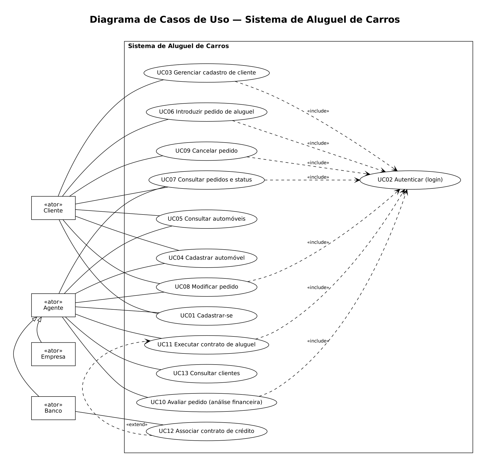
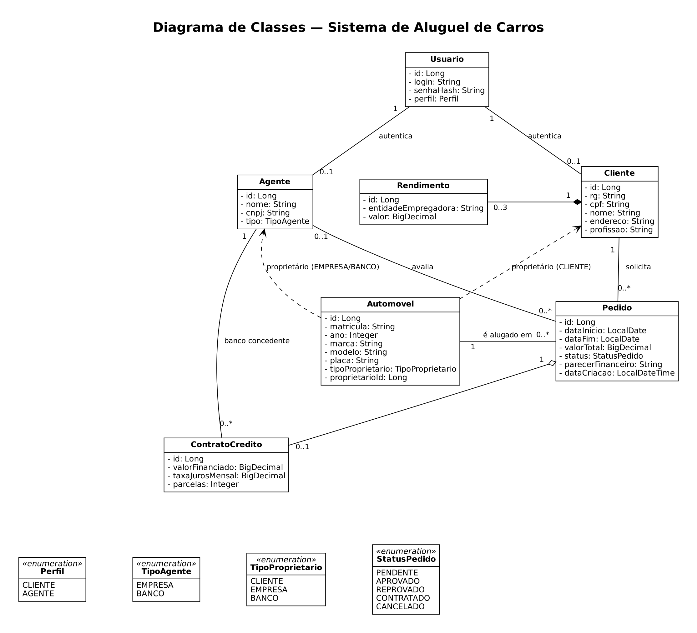
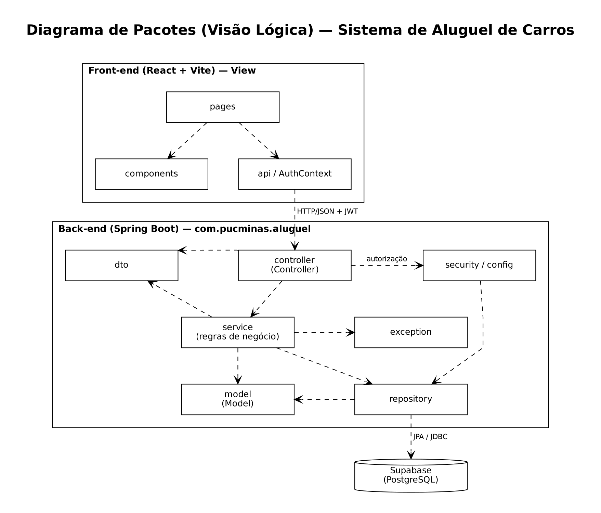

---

# 🚗 Sistema de Aluguel de Carros 👨‍💻

> [!NOTE]
> Plataforma web que centraliza **pedidos de aluguel de automóveis**: o cliente solicita e acompanha o aluguel; empresas e bancos avaliam, contratam e, quando necessário, financiam.

<table>
  <tr>
    <td width="800px">
      <div align="justify">
        O <b>Sistema de Aluguel de Carros</b> foi desenvolvido no <b>Laboratório 02</b> da disciplina <i>Desenvolvimento e Integração de Aplicações Web</i> (Engenharia de Software · PUC Minas), sob orientação do <a href="https://github.com/joaopauloaramuni">Prof. Dr. João Paulo Aramuni</a>. Clientes se cadastram, registram automóveis e criam, modificam, consultam e cancelam pedidos de aluguel. <b>Agentes</b> (empresas e bancos) analisam os pedidos, emitem parecer financeiro e executam o contrato; no caso dos bancos, também é possível associar um <b>contrato de crédito</b>. A aplicação usa <b>Spring Boot</b> (arquitetura MVC) no back-end, <b>React + Vite</b> no front-end e <b>Supabase (PostgreSQL)</b> como banco de dados, com autenticação por <b>JWT</b>.
      </div>
    </td>
    <td>
      <div>
        <!-- TODO: substituir pela logo do projeto -->
        
      </div>
    </td>
  </tr>
</table>

---

## 🚧 Status do Projeto

      

---

## 📚 Índice
- [Links Úteis](#-links-úteis)
- [Sobre o Projeto](#-sobre-o-projeto)
- [Funcionalidades Principais](#-funcionalidades-principais)
- [Tecnologias Utilizadas](#-tecnologias-utilizadas)
- [Arquitetura](#-arquitetura)
- [Instalação e Execução](#-instalação-e-execução)
- [Estrutura de Pastas](#-estrutura-de-pastas)
- [API REST](#-api-rest)
- [Demonstração](#-demonstração)
- [Documentações utilizadas](#-documentações-utilizadas)
- [Autores](#-autores)
- [Agradecimentos](#-agradecimentos)
- [Licença](#-licença)

---

## 🔗 Links Úteis
* 📖 **Histórias de Usuário e RNFs:** [`docs/historias-de-usuario.md`](./docs/historias-de-usuario.md)
* 🧩 **Diagramas UML (PlantUML):** [`docs/diagramas/`](./docs/diagramas) — casos de uso, classes e pacotes
* 🗄️ **Esquema do banco:** [`docs/schema.sql`](./docs/schema.sql)

---

## 📝 Sobre o Projeto

Locadoras e bancos precisam analisar a viabilidade financeira de cada aluguel antes de formalizar o contrato, e o cliente precisa saber em que etapa o seu pedido está. O sistema resolve isso ao reunir, em um único fluxo web, o **pedido do cliente**, a **análise financeira do agente**, a **execução do contrato** e, opcionalmente, o **financiamento por um banco**.

Foi desenvolvido em contexto acadêmico, como protótipo que atende à especificação do laboratório: sistema WEB com autenticação, CRUD de cliente e criação/visualização do status de pedidos de aluguel, com modelagem UML mantida em sincronia com o código.

### Ciclo de vida do pedido

```
PENDENTE ──aprovação──▶ APROVADO ──contrato──▶ CONTRATADO
    ├──reprovação──▶ REPROVADO
    └──cliente cancela──▶ CANCELADO
```

---

## ✨ Funcionalidades Principais

- 🔐 **Autenticação:** login com usuário e senha, senhas com BCrypt e sessão via JWT; todas as rotas, exceto login e cadastros, exigem token.
- 👤 **CRUD de cliente:** cadastro com RG, CPF, nome, endereço, profissão e até 3 rendimentos; consulta, edição e exclusão.
- 🏢 **Cadastro de agentes:** empresas e bancos (CNPJ e tipo).
- 🚘 **Automóveis:** matrícula, ano, marca, modelo e placa, com proprietário (cliente, empresa ou banco).
- 📄 **Pedidos de aluguel:** criação, modificação, cancelamento e acompanhamento de status (com filtro por status).
- ✅ **Análise do agente:** parecer financeiro positivo/negativo e execução do contrato.
- 🏦 **Crédito:** bancos associam contrato de crédito (valor, juros ao mês e parcelas) ao aluguel.
- 🛡️ **Controle de acesso por perfil:** o cliente só acessa os próprios dados e pedidos; os agentes avaliam e modificam.

---

## 🛠 Tecnologias Utilizadas

### 💻 Front-end

* **Biblioteca:** React 19
* **Roteamento:** React Router 7
* **Linguagem:** JavaScript (JSX)
* **Estilização:** CSS puro (`styles.css`)
* **Gerenciamento de estado:** Context API (`AuthContext`)
* **Build Tool:** Vite 7

### 🖥️ Back-end

* **Linguagem/Runtime:** Java 25 (JDK)
* **Framework:** Spring Boot 4.0.0 (Web MVC, Validation)
* **Banco de Dados:** Supabase (PostgreSQL)
* **ORM:** Spring Data JPA / Hibernate
* **Autenticação:** Spring Security + OAuth2 Resource Server (JWT HS256) + BCrypt
* **Build:** Maven

---

## 🏗 Arquitetura

O sistema segue o padrão **MVC**: o **Model** são as entidades JPA, o **Controller** expõe a API REST e a **View** é a SPA React, que consome JSON. A regra de negócio fica na camada **service**, e a persistência na camada **repository**.

- **Padrões adotados:** Controller → Service → Repository, DTOs de entrada e saída, tratamento global de exceções (`GlobalExceptionHandler`).
- **Fluxo de dados:** React (`api.js`) → HTTP/JSON + JWT → Controller → Service → Repository → Supabase.
- **Segurança:** API stateless; a claim `perfil` (`CLIENTE` | `AGENTE`) do token vira a role usada em `@PreAuthorize`.
- **Desenvolvimento local:** o Vite encaminha `/api` ao Spring Boot (`localhost:8080`), evitando CORS; em produção, as origens permitidas vêm de `CORS_ORIGINS`.

### Diagramas

Os diagramas ficam em [`docs/diagramas/`](./docs/diagramas) como arquivos PlantUML e devem ser atualizados a cada mudança no código:

| Diagrama | Arquivo |
| :--- | :--- |
| Casos de Uso | [`casos-de-uso.puml`](./docs/diagramas/casos-de-uso.puml) |
| Classes | [`classes.puml`](./docs/diagramas/classes.puml) |
| Pacotes (Visão Lógica) | [`pacotes.puml`](./docs/diagramas/pacotes.puml) |

### Diagrama de Casos de Uso


### Diagrama de Classes


### Diagrama de Pacotes (Visão Lógica)


---

## 🔧 Instalação e Execução

### Pré-requisitos

* **Java JDK 25**
* **Maven** 3.9+
* **Node.js** 20.19+ e npm
* Um projeto no [Supabase](https://supabase.com)

### 🔑 Variáveis de Ambiente

#### Back-end (Spring Boot)

Copie o modelo e preencha:

```bash
cd backend
cp .env.example .env
```

| Variável | Descrição | Obrigatória |
| :--- | :--- | :---: |
| `SUPABASE_DB_PASSWORD` | Senha do banco no Supabase. | ✅ |
| `JWT_SECRET` | Chave de assinatura dos tokens (mínimo de **32 caracteres**). | ✅ |
| `SUPABASE_DB_URL` | URL JDBC do banco (padrão em `application.yml`). | ❌ |
| `SUPABASE_DB_USER` | Usuário do banco, no formato `postgres.<project-ref>`. | ❌ |
| `CORS_ORIGINS` | Origens permitidas, separadas por vírgula (padrão `http://localhost:5173`). | ❌ |

> [!IMPORTANT]
> O arquivo `.env` **não é versionado**. Nunca faça commit de senhas ou segredos. Ajuste `SUPABASE_DB_URL` e `SUPABASE_DB_USER` para o **seu** projeto Supabase.

#### Front-end (React, Vite)

Em desenvolvimento nenhuma variável é necessária (o proxy do Vite cuida de `/api`). Em produção, defina em `frontend/.env`:

| Variável | Descrição | Exemplo |
| :--- | :--- | :--- |
| `VITE_API_URL` | URL base do back-end. | `https://minha-api.exemplo.com` |

### ⚡ Como Executar a Aplicação

Use **dois terminais**.

#### Terminal 1: Back-end

```bash
cd backend
mvn spring-boot:run
```
🚀 A API sobe em **http://localhost:8080**. As tabelas são criadas automaticamente (`ddl-auto: update`); o esquema de referência está em [`docs/schema.sql`](./docs/schema.sql).

#### Terminal 2: Front-end

```bash
cd frontend
npm install
npm run dev
```
🎨 A aplicação fica em **http://localhost:5173**.

### 🚀 Build de produção

```bash
# Front-end → gera frontend/dist
cd frontend && npm run build

# Back-end → gera backend/target/aluguel-1.0.0.jar
cd ../backend && mvn clean package
java -jar target/aluguel-1.0.0.jar
```

---

## 📂 Estrutura de Pastas

```
.
├── README.md
├── /backend                     # 📁 Spring Boot (com.pucminas.aluguel)
│   ├── .env.example             # 🧩 Modelo das variáveis de ambiente
│   ├── pom.xml
│   └── /src/main
│       ├── /java/com/pucminas/aluguel
│       │   ├── /controller      # 🎮 Endpoints REST (Auth, Cliente, Automóvel, Pedido)
│       │   ├── /service         # ⚙️ Regras de negócio
│       │   ├── /repository      # 🗄️ Repositórios JPA
│       │   ├── /model           # 🧬 Entidades (Cliente, Agente, Automovel, Pedido, ...)
│       │   ├── /dto             # ✉️ Objetos de requisição/resposta
│       │   ├── /security        # 🛡️ Token JWT e usuário logado
│       │   ├── /config          # 🔧 SecurityConfig (JWT, CORS, rotas públicas)
│       │   └── /exception       # 💥 ApiException e handler global
│       └── /resources
│           └── application.yml  # ⚙️ Configuração (banco, JWT, CORS)
│
├── /frontend                    # 📁 React + Vite
│   ├── vite.config.js           # 🔌 Proxy /api → localhost:8080
│   └── /src
│       ├── /pages               # 📄 Login, Cadastro, Clientes, Automóveis, Pedidos, ...
│       ├── /components          # 🧱 Layout, ClienteForm, PedidoCard, StatusTrilha, Campo
│       ├── AuthContext.jsx      # 🔐 Sessão do usuário
│       └── api.js               # 🔌 Cliente HTTP da API
│
└── /docs                        # 📚 Documentação
    ├── historias-de-usuario.md  # 📝 Histórias de usuário e RNFs
    ├── schema.sql               # 🗄️ Esquema do banco
    └── /diagramas               # 🧩 casos-de-uso, classes e pacotes (.puml)
```

---

## 🔌 API REST

| Método | Rota | Acesso | Descrição |
| :---: | :--- | :---: | :--- |
| POST | `/api/auth/login` | Público | Autentica e retorna o token JWT. |
| POST | `/api/auth/agentes` | Público | Cadastra agente (empresa ou banco). |
| POST | `/api/clientes` | Público | Cadastro prévio de cliente. |
| GET | `/api/clientes` | Agente | Lista clientes. |
| GET | `/api/clientes/me` | Cliente | Dados do próprio cadastro. |
| GET/PUT/DELETE | `/api/clientes/{id}` | Autenticado* | Consulta, edita e exclui cliente. |
| GET/POST | `/api/automoveis` | Autenticado | Lista e cadastra automóveis. |
| PUT/DELETE | `/api/automoveis/{id}` | Proprietário | Edita e exclui automóvel. |
| POST | `/api/pedidos` | Cliente | Cria pedido de aluguel. |
| GET | `/api/pedidos?status=` | Autenticado* | Lista pedidos (cliente vê só os seus). |
| GET/PUT | `/api/pedidos/{id}` | Autenticado* | Consulta e modifica pedido. |
| POST | `/api/pedidos/{id}/cancelar` | Cliente | Cancela pedido. |
| POST | `/api/pedidos/{id}/avaliacao` | Agente | Parecer financeiro (aprova/reprova). |
| POST | `/api/pedidos/{id}/contrato` | Agente | Executa contrato (crédito só para bancos). |

\* Regras de propriedade e perfil aplicadas na camada de serviço.

---

## 🎥 Demonstração

<!-- TODO: adicionar prints/GIFs da aplicação (hospede em docs/img ou GitHub Pages) -->

| Tela | Captura de Tela |
| :---: | :---: |
| **Login** | _Sua captura aqui_ |
| **Cadastro de Cliente** | _Sua captura aqui_ |
| **Criação de Pedido** | _Sua captura aqui_ |
| **Status do Pedido** | _Sua captura aqui_ |

---

## 🔗 Documentações utilizadas

* 📖 [Spring Boot](https://docs.spring.io/spring-boot/index.html)
* 📖 [Spring Security – OAuth2 Resource Server (JWT)](https://docs.spring.io/spring-security/reference/servlet/oauth2/resource-server/jwt.html)
* 📖 [React](https://react.dev/reference/react)
* 📖 [Vite](https://vitejs.dev/config/)
* 📖 [Supabase](https://supabase.com/docs)
* 📖 [Diagrama de Pacotes (Visão Lógica)](https://www.visual-paradigm.com/guide/uml-unified-modeling-language/what-is-package-diagram/)

---

## 👥 Autores

| 👤 Nome | 🎓 Matrícula | :octocat: GitHub |
|---------|--------------|------------------|
| _Nome 1_ | _preencher_ | [@usuario1](https://github.com/usuario1) |
| _Nome 2_ | _preencher_ | [@usuario2](https://github.com/usuario2) |

---

## 🙏 Agradecimentos

* [**Engenharia de Software PUC Minas**](https://www.instagram.com/engsoftwarepucminas/) – Pelo apoio institucional e estrutura acadêmica.
* [**Prof. Dr. João Paulo Aramuni**](https://github.com/joaopauloaramuni) – Pelas orientações em Arquitetura de Software e Desenvolvimento Web.

---

## 📄 Licença

<!-- TODO: adicionar arquivo LICENSE ao repositório (o template sugere MIT) -->
Projeto acadêmico, distribuído sob a **Licença MIT**.

---
